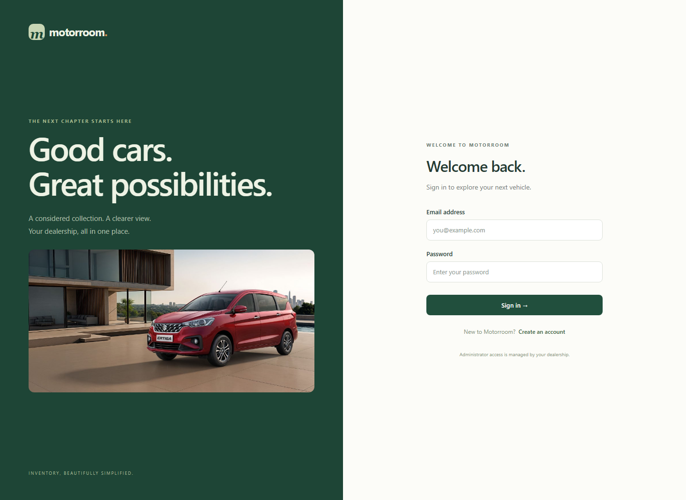
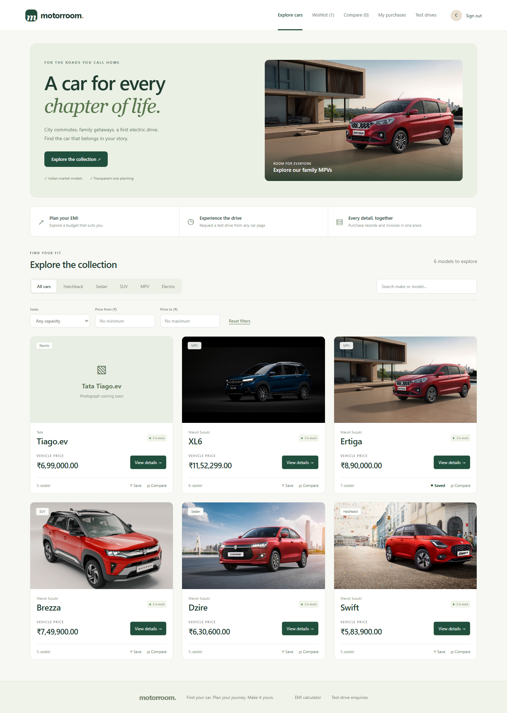
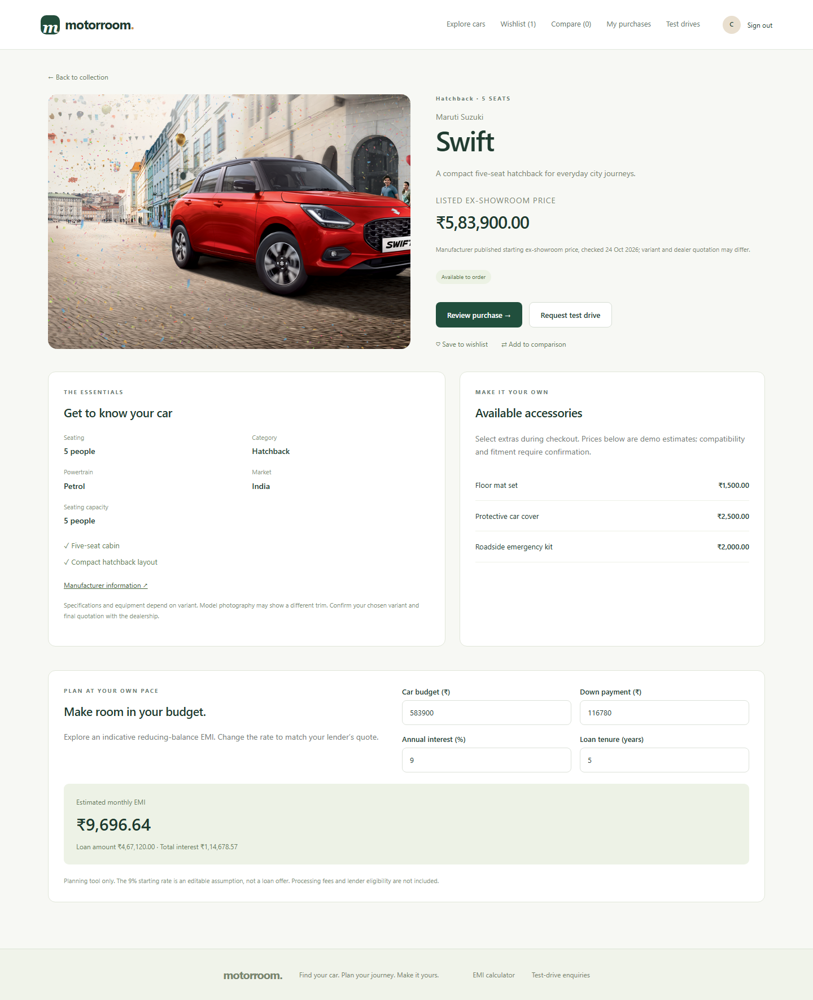
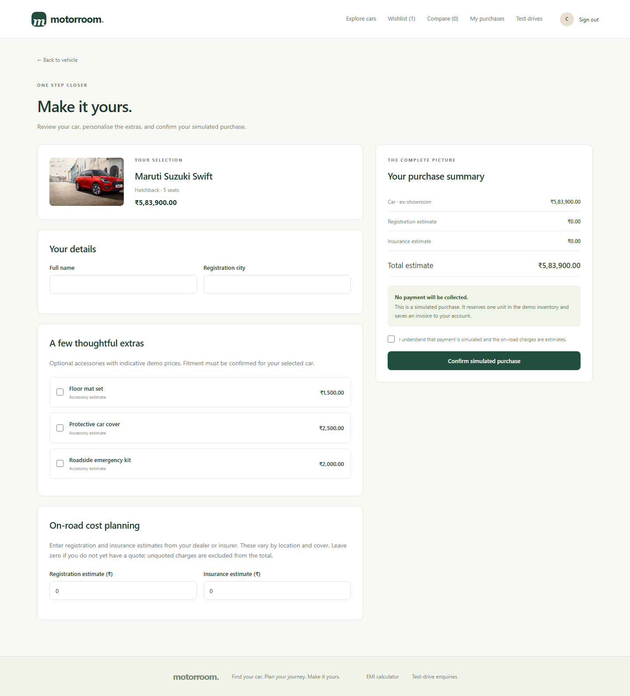
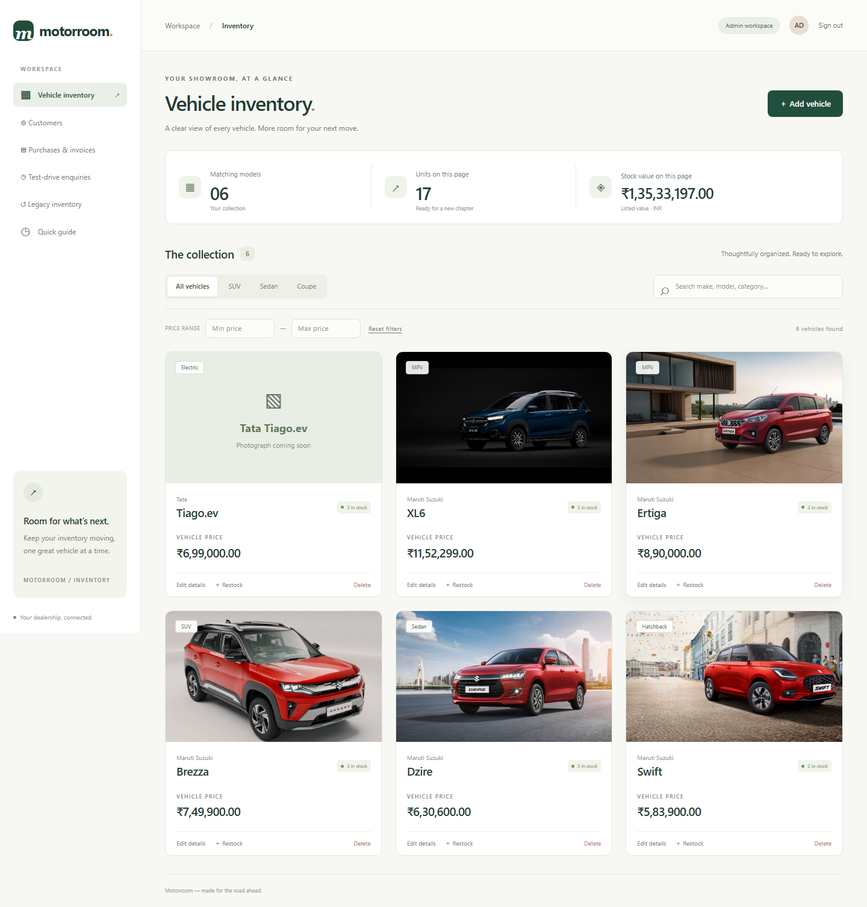
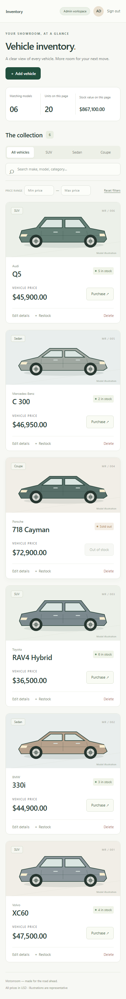

# Motorroom — Car Dealership Inventory

An Indian dealership demo built with the existing FastAPI, SQLite, React, TypeScript, Vite, and Tailwind application. Customers can explore cars, save a wishlist, compare up to three models, plan EMI, request a test drive, and complete a simulated purchase with private purchase history and downloadable invoices. Administrators have a separate inventory and customer management workspace.

Prices use Indian rupees and Indian digit grouping. The six Indian catalogue models use documented manufacturer prices and five model-specific manufacturer photos; Tiago.ev has a labelled photo fallback. See [vehicle sources](docs/VEHICLE_SOURCES.md). Purchases are explicitly simulated: no payment, delivery booking, SMS, or email is sent. Registration and insurance are user-entered planning estimates; zero means unquoted and excluded. Accessory prices are labelled demo estimates. Invoices download as printable HTML, with browser Print → Save as PDF available.

## Submission links

- Public source repository: [kinshikmalpani/car-dealership-inventory-system](https://github.com/kinshikmalpani/car-dealership-inventory-system)
- Live application: deployment pending; a local URL is not a live submission link.
- [Test results](docs/TEST_REPORT.md) and [raw AI conversation excerpts](PROMPTS.md).
- [Deployment instructions](docs/DEPLOYMENT.md).

## Prerequisites

- Python 3.13 (tested with 3.13.3)
- Node.js 24 (tested with 24.12.0) and npm
- Git
- Two terminal windows

## Run locally on Windows (PowerShell)

Start in this repository's root directory. Use `npm.cmd` if PowerShell blocks the npm script.

### Backend

```powershell
cd backend
python -m venv .venv
.\.venv\Scripts\python.exe -m pip install -r requirements.lock.txt
Copy-Item .env.example .env
.\.venv\Scripts\python.exe -c "import secrets; print(secrets.token_urlsafe(48))"
```

Paste the generated value into `JWT_SECRET` in `backend/.env`. The application rejects a missing, short, or unchanged placeholder secret. Do not commit `.env`.

```powershell
.\.venv\Scripts\python.exe -m alembic upgrade head
.\.venv\Scripts\python.exe -m app.cli create-admin --email owner@example.com
.\.venv\Scripts\python.exe -m app.cli seed
.\.venv\Scripts\python.exe -m uvicorn app.main:create_app --factory --reload --host 127.0.0.1 --port 8000
```

The admin command asks for a password of at least 10 characters and confirmation. It creates a new account and never promotes an existing customer account. Choose your own email instead of `owner@example.com`. Seeding is optional and adds missing Indian make/model listings without overwriting existing prices, metadata, or stock. Initial quantities of three are demo inventory, not claims about a real dealership.

### Frontend (second terminal, from repository root)

```powershell
cd frontend
npm.cmd ci
npm.cmd run dev
```

Open [Motorroom](http://127.0.0.1:5173). Sign in with the admin account you created, or register a customer account. The frontend proxies `/api` to port 8000. Interactive API documentation is at [Swagger UI](http://127.0.0.1:8000/docs).

For macOS/Linux, replace `.venv\Scripts\python.exe` with `.venv/bin/python`, `Copy-Item` with `cp`, and `npm.cmd` with `npm`.

## Upgrade an existing installation

Stop the backend, take a SQLite backup, then run `python -m alembic upgrade head` and `python -m app.cli seed` using your existing backend virtual environment and `.env`. Restart the backend and frontend. Do not recreate the database or replace the signing secret. Migration `0002_customer_commerce` retains accounts, hashed passwords, vehicle IDs, original prices, and stock; it adds metadata and commerce tables. Previously dollar-denominated inventory is marked USD and hidden from customer shopping until explicitly repriced by an admin. Old inventory-only purchases cannot be reconstructed as invoices because the original application did not store orders.

## Tests and production build

From `backend/`:

```powershell
.\.venv\Scripts\python.exe -m pytest -q --cov=app --cov-report=term-missing --cov-report=xml:../docs/coverage.xml --junitxml=../docs/backend-tests.xml
```

From `frontend/`:

```powershell
npm.cmd test
npm.cmd run build
npx.cmd playwright install chromium
npm.cmd run test:e2e
```

Stop development servers on ports 8000 and 5173 before running browser tests. Playwright starts its own servers, applies real migrations to a temporary SQLite database, and creates disposable test users. Its known test credentials exist only in the isolated test database and must never be used in a deployment. Browser tests produce screenshots under `docs/screenshots/` and a JUnit report under `docs/`.

`npm run build` checks TypeScript and produces `frontend/dist/`. GitHub Actions repeats backend tests, frontend tests, the build, dependency auditing, and browser journeys. The workflow is provided locally; it runs remotely once the repository is published.

## API and permissions

Protected requests use `Authorization: Bearer <access_token>`. Register and login accept JSON `{ "email": "you@example.com", "password": "your-password" }`. Login returns the access token and user profile. Tokens expire after 30 minutes by default.

| Method | Route | Access |
|---|---|---|
| POST | `/api/auth/register` | Public; creates customer only |
| POST | `/api/auth/login` | Public |
| GET | `/api/auth/me` | Signed-in user |
| GET | `/api/vehicles` | Signed-in user |
| GET | `/api/vehicles/search` | Signed-in user |
| POST | `/api/vehicles` | Admin |
| PUT | `/api/vehicles/:id` | Admin |
| DELETE | `/api/vehicles/:id` | Admin |
| GET | `/api/vehicles/:id` | Signed-in user; customers see INR listings only |
| POST | `/api/vehicles/:id/quote` | Customer |
| POST | `/api/vehicles/:id/purchase` | Customer only; administrators cannot buy |
| GET | `/api/accessories` | Signed-in user |
| GET | `/api/orders` | Customer; own orders only |
| GET | `/api/orders/:reference` | Owner or admin |
| GET | `/api/orders/:reference/invoice` | Owner or admin |
| GET / PUT / DELETE | `/api/wishlist` / `/api/wishlist/:id` | Customer; own wishlist only |
| GET / POST | `/api/test-drives` | Customer; own enquiries only |
| GET | `/api/admin/customers`, `/api/admin/orders`, `/api/admin/test-drives` | Admin |
| PATCH | `/api/admin/test-drives/:id` | Admin; update enquiry status |
| POST | `/api/vehicles/:id/restock` | Admin |
| GET | `/api/health` | Public |

Create fields: `make`, `model`, `category`, `price`, and `quantity`; optional details include `seating_capacity` (2–12), `description`, `image_url`, `source_url`, `features`, `specifications`, and `price_note`. New prices are INR. Each vehicle retains its unique internal database ID; customer cards use make and model. Edit accepts all detail fields but deliberately excludes quantity; use purchase/restock to change stock. Restock accepts `{ "quantity": 3 }`. Purchase buys one unit and returns a permanent order snapshot and reference. The optional JSON body accepts `accessory_ids`, `registration_estimate`, `insurance_estimate`, `buyer_name`, `city`, `expected_total`, and `idempotency_key`. The frontend supplies all review fields and a stable key for retries; reusing a key with different details returns 409. A bodyless request remains supported for older customer API clients and now also creates an order.

Search parameters: `q` (make/model/category), `make`, `model`, `category`, `min_price`, `max_price`, `seating_capacity`, `currency` (INR by default; USD restricted to admins), `limit` (1–100, default 12), and `offset`. Results are `{ "items": [...], "total": 6 }`, newest first. Sold-out listings remain visible with purchasing disabled. Category filters match text case-insensitively; custom categories can be found through search.

Expected errors: 401 authentication, 403 permission, 404 missing vehicle, 409 duplicate account or stock conflict, and 422 invalid input. Money is returned as a two-decimal string.

## Architecture and design decisions

```text
backend/
  app/          routes, request schemas, authentication, models, inventory service, CLI
  migrations/   versioned Alembic schema migrations
  tests/        API, concurrency, security, persistence, CLI, and migration tests
frontend/
  src/          typed API client, authentication, inventory UI, shared dialogs/cards
  e2e/          Playwright customer and admin journeys
docs/           verification reports, screenshots, and project notes
```

- SQLite is a persistent local file (`backend/dealership.db` by default), never an in-memory production store.
- Prices remain integer minor units in the existing `price_cents` column (paise for INR), parsed as decimal amounts at the API boundary. The additive migration records currency explicitly.
- Checkout acquires a SQLite write transaction before reading price/idempotency state, uses a conditional stock decrement, and saves the order in the same transaction. Concurrent buyers cannot oversell the last unit; any order-write failure rolls stock back. Database constraints also enforce nonnegative inventory. Order snapshots and invoices survive vehicle edits/deletion.
- Detail edits do not write stock quantities, preventing stale admin forms from overwriting purchases.
- Passwords use Argon2 hashing; JWTs use a configured signing secret and expiry. Authorization reads the current database role, so role changes take effect immediately.
- Tokens are stored in browser session storage, cleared on sign-out, and removed after a 401 response. Sign-out is local; an already-issued token remains valid until expiry. There is no password recovery, email verification, refresh-token mechanism, or server-side token revocation in this kata.
- Customer-facing inventory uses INR prices. No implicit currency conversion is applied. Admins manage vehicle listings and stock through the main inventory workspace.
- Alembic owns schema changes. Automatic table creation is used only by isolated unit/integration tests.

For an internet-facing deployment, use HTTPS, a persistent writable SQLite volume, backups, a production process manager, and rate limiting at the application gateway. Serve the frontend and `/api` under the same origin or explicitly configure the API proxy. Serverless ephemeral storage is not appropriate for this SQLite setup. For this assessment, the owner selected a free Render demo with ephemeral SQLite and explicitly accepted resets. The hosted demo must not be used to retain real customer records. Local SQLite remains persistent. Deployment status and instructions are in `docs/DEPLOYMENT.md`.

## Screenshots









## My AI Usage

OpenAI Codex was used collaboratively to interpret the brief, discuss stack options, design the architecture and tests, implement the API and frontend, troubleshoot local dependency/environment issues, run verification, and prepare documentation. The human selected FastAPI and SQLite, delegated the frontend language choice, confirmed admin permissions, and approved the supporting toolset.

AI generated substantial portions of this code and its tests. The Git history preserves failing backend acceptance tests before implementation and the subsequent passing implementation. AI-assisted commits include a co-author trailer. The project was written for this task; no existing dealership repository was copied. Official FastAPI and Tailwind documentation informed library usage:

- [FastAPI security documentation](https://fastapi.tiangolo.com/tutorial/security/oauth2-jwt/)
- [Tailwind with Vite](https://tailwindcss.com/docs/installation/using-vite)

Observed impact: AI accelerated the initial implementation and verification while exposing decisions that still needed explicit review, including permissions, stock concurrency, and dependency versions. Passing tests provide evidence for the exercised cases, not proof of production readiness. The developer should add their own interview reflection after reviewing and using the application; this section does not claim manual work or personal learning that has not occurred.

### Enhancement work, 24–25 October 2026

Codex inspected the existing repository, APIs, authentication, SQLite data, tests, and Git status before enhancing it. The original stack and history were retained. New backend acceptance tests were committed in `ed5e864` and observed failing before implementation. A later high-price checkout regression was also reproduced before its fix. Frontend integration tests were expanded alongside implementation; not every UI change followed a strict red/green cycle.

AI helped implement additive migrations, transactional purchases, permission checks, snapshot invoices, sourced catalogue data, and the customer/admin interfaces. Manufacturer sources informed prices and minimal specifications; unavailable detailed specifications were not invented. Review caught a modal-test timing issue and an overly restrictive total validation limit. The local database was backed up and preservation was checked during migration. These are automated-agent checks, not claims of human testing. The original AI usage account above remains part of the project history.

### Deliverable preparation

Codex prepared the Docker image definition, free Render Blueprint, production static-file serving, deployment instructions, and raw deliverables conversation export. A production-serving acceptance test was written and observed failing before its implementation. The owner explicitly chose free hosting and accepted resetting SQLite storage. No local accounts or database files are included in the image or public repository. Windows file encoding and Git credential-store issues were encountered; the encoding issue was corrected and the production build rerun successfully. Hosted deployment and GitHub Actions results are reported separately from local tests.

See root `PROMPTS.md` for original conversation records and `docs/TEST_REPORT.md` for verification evidence.
